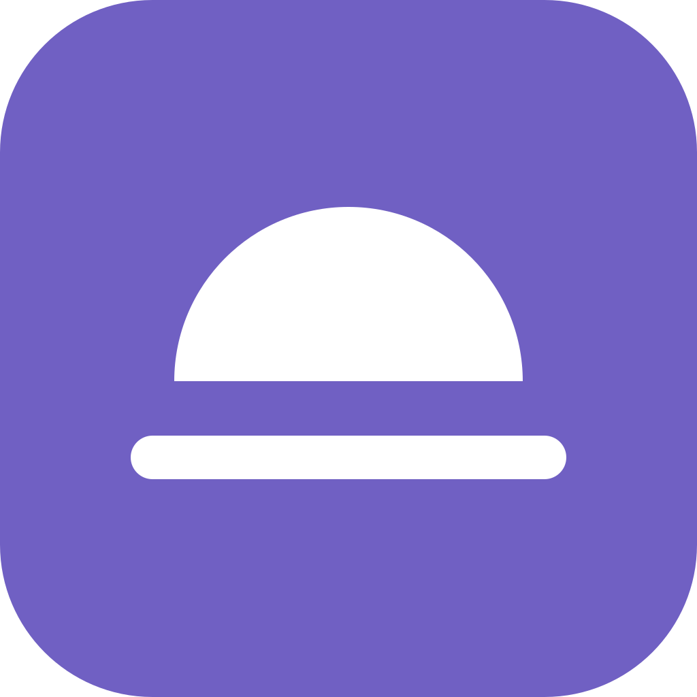
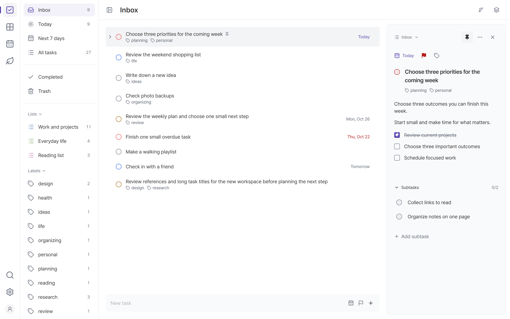

<p></p>

# Rillday

A modern personal planner you can self-host

[Download for Windows](https://github.com/nbsp1221/rillday/releases/latest/download/Rillday_windows_x64_setup.exe) · [Try the demo](https://rillday-demo.retn0.dev) · [Self-host](docs/self-hosting.md) · [Website](https://rillday.retn0.dev)

Rillday is a free, open-source personal planner inspired by TickTick. Work locally without an account, or connect your devices through a server you control.

<picture>
  <source media="(prefers-color-scheme: dark)" srcset="apps/landing/public/screenshots/tasks-dark.png">
  
</picture>

## Features

- Organize tasks with lists, labels, subtasks, recurring schedules and Markdown notes.
- Plan your day, week or month in the calendar, with drag scheduling and agenda and year views.
- Choose what matters with an Eisenhower matrix.
- Build routines with habit goals, check-ins, history and statistics.
- Keep working offline, with optional synchronization and explicit conflict review.
- Make it yours with light and dark themes and English and Korean interfaces.

## Get started

### Windows

[Download the Windows x64 installer](https://github.com/nbsp1221/rillday/releases/latest/download/Rillday_windows_x64_setup.exe), install Rillday and start planning. No account, server, Node.js or Docker is required for local use.

Prefer no installation? Download the [Windows ZIP](https://github.com/nbsp1221/rillday/releases/latest/download/Rillday_windows_x64.zip), extract it and run `rillday-desktop.exe`. Both downloads use the same first-run data folder selection.

See the [Windows guide](docs/windows.md) for installation, updates and data storage.

### Self-host

Run one Rillday container with Docker Compose. It serves the web application and synchronization API and stores server data in a persistent SQLite volume.

Download `compose.yaml` and `example.env` from the [latest release](https://github.com/nbsp1221/rillday/releases/latest), save the environment file as `.env`, and follow the [self-hosting guide](docs/self-hosting.md). From that installation directory, start the server with:

```sh
docker compose up -d
```

Open **http://127.0.0.1:4287/** on the server computer. Set up the first administrator before exposing the server to others. The administrator adds ordinary users; the server supports up to **10 private accounts**, including the administrator.

### Try it first

The [demo](https://rillday-demo.retn0.dev) opens with example data, requires no account and keeps your edits in that browser. It has an example-data reset and does not connect to a synchronization server. Use the Windows application or your own server for personal data.

## Your data

Without a connected account, work stays in your browser or Windows application profile. Hosting the web app does not automatically enable synchronization. Connect an account through **Settings → Sync** to use the same server data on multiple devices.

When local work already exists, review it before adding it to the account or opening the server's data. Disconnecting lets you keep or remove the device copy and preserves server originals. Unsent edits cannot be silently removed.

Export local data from **Settings → Data and backups**. Clearing browser site data can remove local work, and changing the website's scheme, hostname or port selects separate browser storage. Synchronization propagates deletions and does not replace a backup. See [server backup and restore](docs/self-hosting.md#back-up-and-restore).

## Development and contributing

See [development and testing](docs/development.md), [architecture](docs/architecture.md) and [UI conventions](docs/ui.md). Use [GitHub Issues](https://github.com/nbsp1221/rillday/issues) for bug reports and feature requests.

## License

Licensed under the EUPL. See [LICENSE](LICENSE).
