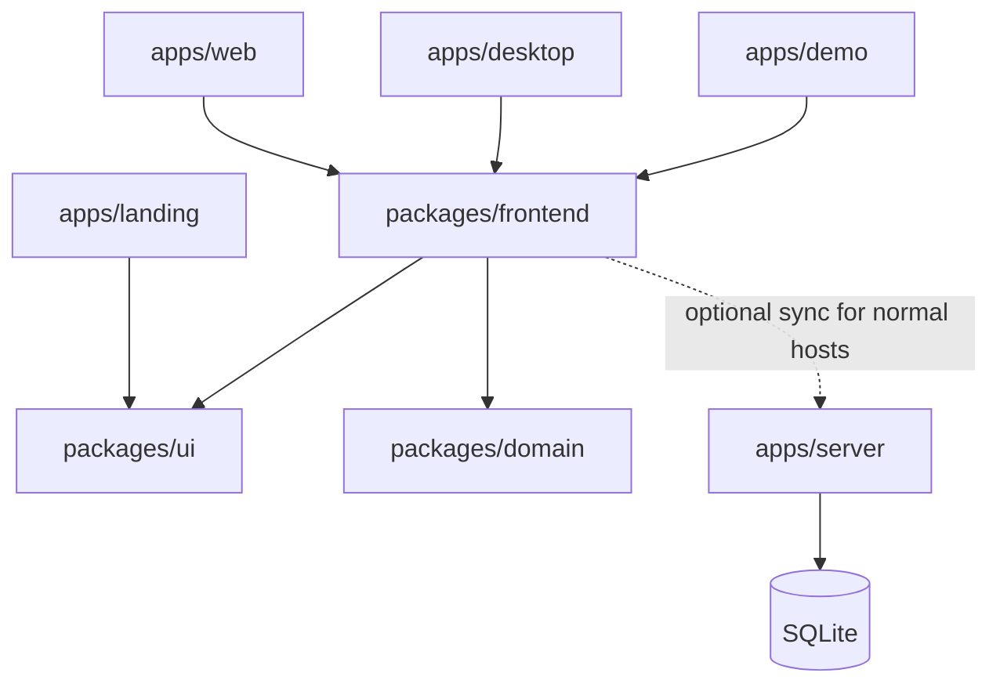

# Architecture

Web and Windows share product rules, a local application and a React interface. Each host selects storage and platform capabilities at its entry point. Local use does not require an account or synchronization server.

## Responsibilities

- `apps/web`: browser composition, cookie sessions, PWA lifecycle and a Vite build.
- `apps/desktop`: Tauri composition, its own renderer build, Windows credentials and application-close integration.
- `apps/server`: optional authentication, account isolation, opaque document replication, SQLite persistence and maintenance. It does not execute task or habit actions.
- `apps/landing`: static product website, with its own entry point and no application or domain imports.
- `apps/demo`: browser-only sample workspace using the shared frontend, isolated storage and disabled server capabilities.
- `packages/domain`: pure task, list, label, schedule, habit, check-in and matrix concepts. Each concept owns its validation and product rules. Time and new identities are explicit caller inputs; there are no database, HTTP, UI or repository-package imports.
- `packages/frontend`: shared application use cases, presentation and reusable adapters. Application-owned ports separate user actions from native replication, local storage and credentials.
- `packages/ui`: business-free shadcn controls and theme support.
- `packages/test-support`: synthetic accounts, server fixtures and test artifact ownership. Production code cannot import it.
- `packages/typescript-config`: shared compiler presets only.

`package.json` declares dependencies and public exports. Turbo checks package isolation and allowed dependency tags; Oxlint restricts production imports of server and test-only APIs. TypeScript resolves actual imports and package exports.

The dotted edge is a network connection, not a source dependency. Frontend integration tests may import the server as a development dependency. The server serves the web build; Tauri embeds its independent desktop renderer. Neither renderer imports the other host.

## Application and domain

`@repo/frontend/application` exposes the application factory, capability contracts and product actions/read models without React, DOM or concrete storage imports. `@repo/frontend` exposes `RilldayApplication`, which receives that application. Hosts explicitly select `@repo/frontend/storage/indexeddb` and their credential adapter.

The domain is organized by product concept: `task-management/{tasks,completion,scheduling,lists,labels}`, `habit-tracking/{habits,rules,check-ins}`, `matrix`, and whole-collection rules in `workspace`. Its public API names business actions such as `completeTask` and `recordCheckIn`. It has no generic command, transaction, receipt or delivery model.

An application action applies those rules to a typed workspace. The repository accepts the whole action synchronously and reports durable completion separately. Read models preserve unchanged record identity; React observes them through `useSyncExternalStore`. Forms own unsubmitted drafts. Views do not read storage keys, native handles or network frames.

Application-local Undo uses Immer patches with native record-version guards. It retains up to 40 groups for 15 minutes, groups typing within 800ms, and rejects compensation that would overwrite a later edit or violate a product invariant. Undo history belongs to the current session and is not synchronized.

Host close and update integrations call `application.flushForExit()`. This drains accepted local writes and preferences, without submitting unfinished forms or waiting for an unavailable server.

## Local persistence and replication

Both current hosts select IndexedDB. Web data belongs to its origin; Windows data belongs to its WebView profile. The storage choice does not change application or domain rules. Web credentials persist in server-owned HttpOnly cookies; Windows credentials use the OS vault. Browser bearer tokens remain in memory.

The Automerge adapter owns native documents, durable binary snapshots, field-level merge and conflict inspection. The official Repo BroadcastChannel adapter connects tabs; the official WebSocket adapter connects an optional server. Short Web Locks prevent concurrent snapshot saves from overwriting unseen native history. The SDK owns synchronization and reconnects, with no separate application outbox, replay loop, sequence cursor or delivery-receipt protocol.

Disjoint changes merge. Same-field and product-invariant conflicts retain their alternatives until explicit review. The domain validates candidate resolutions. Storage failures remain visible and retryable; synchronization reports success only after the server acknowledges the current native heads from committed SQLite storage.

Connecting local data to an account is a separate application action from signing in. It reviews both collections, preserves a local recovery archive, and either includes local records or opens the account's collection. A brief input/network pause stabilizes reviewed native revisions during publication. A rejected binding leaves the source active. After binding commits, an inclusion or cleanup failure leaves the connected session active and the source available for manual recovery. Retained source documents expose later durable edits through the existing backup list, while captured archives remain immutable.

Backup files contain native document history. Restoring a connected workspace writes the replacement in its existing synchronized lineage. Restoring a local workspace creates a new document identity. Settings and host metadata remain outside synchronized product data.

## Server boundaries

`src/modules/accounts` owns Better Auth, administrator protection, account capacity, password recovery and session revocation. Its `domain` folder contains account policies, `application` coordinates use cases through ports, and `adapters` implements authentication and SQLite access. Other modules consume its public `index.ts`.

`src/modules/sync` registers and authenticates one native document per account. It transports native SDK messages and persists opaque binary snapshots; it never imports product-domain code. Every native frame and outgoing update checks current session authority. SQLite WAL and FULL synchronous commits precede persistence acknowledgments.

Fastify owns HTTP policy and lifecycle, Better Auth owns credentials and sessions, and the native SDK owns document synchronization. SQLite stores accounts and document blobs. Standard SQLite backup and restore retain native history, allowing returning clients to merge through the same engine.

Timed schedules retain civil date, wall time and IANA zone. The domain derives the instant for display instead of persisting a second schedule interpretation. Date-only tasks and habit accounting dates remain stable across device time zones.

## Interface

Shared controls use shadcn/ui components. Product code owns content and domain actions, while upstream primitives own generic placement, focus and keyboard behavior. The [UI conventions](ui.md) describe tokens, layout and interaction checks.

`packages/frontend/src/presentation` follows Feature-Sliced Design: `app`, `pages`, `widgets`, `features`, `entities` and `shared`. Imports go to lower layers; consumers use a slice's public `index.ts`. Application and domain modules are organized by responsibility rather than React's layer structure. Platform adapters implement the application-owned contracts without importing presentation.

The DOM presentation is shared by web and Tauri. Hosts can reuse domain rules and headless application behavior through their own renderer and capability implementations.

## Distribution

`apps/landing` is a static product site with no application or domain imports. `apps/demo` is an independent browser entry point for the shared frontend. It uses the isolated demo storage namespace, refuses remote document adapters, and exposes a connection port with server actions disabled. No credential session is created. Resetting sample data uses the normal coordinated archive flow, including updates to other open demo tabs.

The self-hosted image serves the web app and API together. A persistent SQLite volume holds accounts, server identity and native documents. Recreating the container preserves that volume. The Windows installer embeds its own renderer and supports local use without a server.

The official demo is a separate static build of the web app, with synthetic data and browser-local storage. It offers no login or server connection. It shares application and domain code with installed clients. The landing page and demo are static deployment targets; neither runs an account or synchronization backend.

Versioned releases provide the Windows installer, container image, Compose configuration and checksums. See [self-hosting](self-hosting.md) and [Windows installation](windows.md) for the user-facing setup paths.
